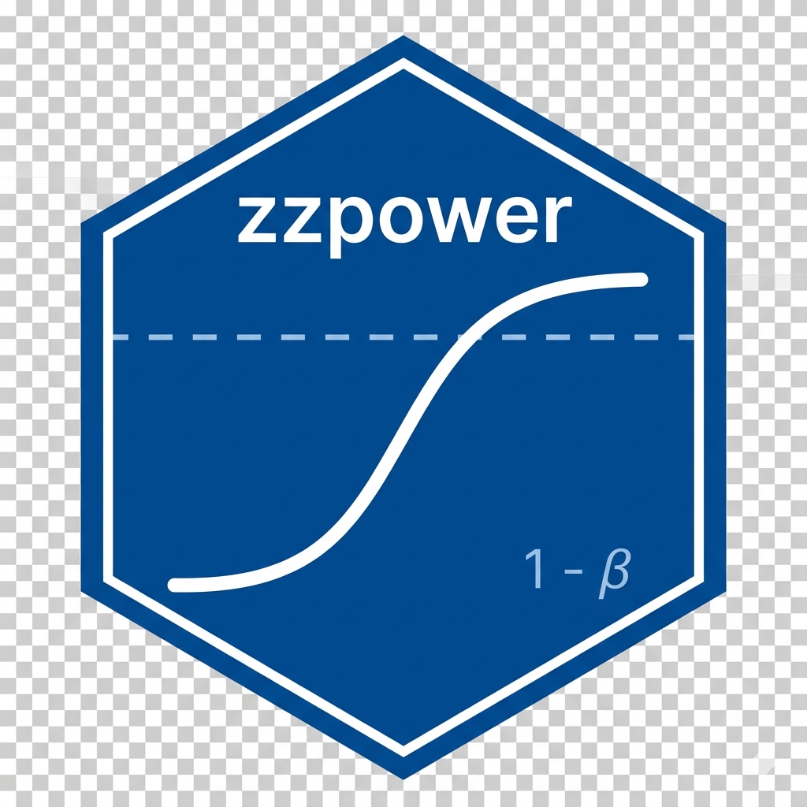

# zzpower <a href="https://rgt47.github.io/zzpower/"></a>

<!-- badges: start -->
[](https://lifecycle.r-lib.org/articles/stages.html#experimental)
[](https://github.com/rgt47/zzpower/actions/workflows/r-package.yml)
[](https://www.gnu.org/licenses/gpl-3.0)
<!-- badges: end -->

The `zzpower` package provides a Shiny application for conducting power analysis and sample size calculations across 14 statistical tests used in clinical trial designs (see [Supported Statistical Tests](#supported-statistical-tests)). The same calculations are available programmatically through `power_calc()` and `power_table()`.

## Features

- **Multiple Effect Size Methods**: Several effect-size specifications per test where applicable; for example, the two-sample t-test accepts Cohen's d, percentage reductions, difference in change scores, and treatment group changes
- **Design Considerations**: Accounts for dropout rates (10% by default; see below) and, for two-group designs, unequal group allocation ratios
- **Interactive Visualizations**: Real-time power curves and detailed results tables
- **Report Generation**: Downloadable reports in text, HTML, PDF, or Word format (PDF and Word require the suggested `rmarkdown` package, and PDF also requires a LaTeX installation)
- **Advanced Settings**: Configurable Type I error rates and one-sided vs two-sided testing

## Installation

The development version may be installed of zzpower from [GitHub](https://github.com/) with:

``` r
# install.packages('pak')
pak::pak('rgt47/zzpower')
```

## Usage

To launch the interactive application:

```r
library(zzpower)
launch_zzpower()
```

The application will open in the default web browser and provide an interactive interface for:

1. **Sample Size Planning**: Set total sample size and expected dropout rates
2. **Effect Size Specification**: Choose from multiple methods to specify the expected treatment effect
3. **Advanced Configuration**: Adjust randomization ratios, Type I error rates, and testing approaches
4. **Results Visualization**: View interactive power curves and detailed results tables
5. **Report Generation**: Download reports in multiple formats

## Effect Size Methods

For the two-sample t-test, the application supports four different approaches to specifying effect sizes (other tests use the effect sizes listed in the table below):

- **Standard Deviation Units (Cohen's d)**: Direct specification of standardized effect sizes
- **Percent Reduction**: Effect size specified as percentage reduction from placebo  
- **Difference in Change Scores**: Absolute difference between treatment groups in outcome units
- **Change in Active Group**: Specifying the treatment group change directly

## Example Workflow

1. Launch the application with `launch_zzpower()`
2. Set the total planned sample size using the slider
3. Specify expected dropout rate
4. Select the preferred effect size method
5. Set the range of effect sizes to evaluate
6. Review the power curve and identify the detectable effect size at 80% power
7. Download a report documenting your power analysis

**Dropout default.** Every test applies a 10% expected dropout rate
unless it is changed, in the app and in the programmatic functions
`power_calc()` and `power_table()`. The planned sample size is treated
as enrolled, and power is computed at the evaluable N,
`N enrolled x (1 - dropout)`, so it is lower than `pwr` reports for the
same nominal N (0.758 rather than 0.801 for a two-sample t-test with
N = 128 and d = 0.5). Set the dropout rate to 0 (`dropout = 0`) to
obtain unadjusted results; the rate in effect is printed with every
result and stated in the downloaded reports.

## Dependencies

This package builds on several the following R packages:

- `shiny` - Web application framework
- `bslib` - Bootstrap themes and components  
- `bsicons` - Bootstrap icons
- `pwr` - Power analysis calculations
- `ggplot2` - Data visualization
- `DT` - Interactive tables
- `htmltools` - HTML report construction
- `rlang` - Internal utilities
- `rmarkdown` (suggested, optional) - PDF and Word report generation

## Supported Statistical Tests

The application includes 14 statistical tests via a scalable plugin architecture:

| Test | Use Case | Effect Size |
|:-----|:---------|:------------|
| Two-Sample t-test | Parallel RCT designs | Cohen's d, % reduction |
| Paired t-test | Before-after designs | Standardized difference |
| One-Sample t-test | Single-group vs reference | Cohen's d |
| Two Proportions | Binary outcomes | Proportions, OR, RR |
| Correlation | Bivariate relationships | Correlation r |
| Log-rank | Survival comparisons | Hazard ratio |
| Fisher's Exact | Small-sample binary outcomes | Odds ratio |
| Cochran-Armitage Trend | Ordered categorical exposure | Trend in proportions |
| One-Way ANOVA | Multi-group continuous outcomes | Cohen's f |
| McNemar | Paired binary outcomes | Discordant-pair proportion |
| Mixed Model (Slopes) | Longitudinal difference in slopes | Slope difference, within-subject correlation |
| Cluster RCT | Cluster-randomized continuous outcomes | Effect size, ICC |
| Cluster Proportions | Cluster-randomized binary outcomes | Proportions, ICC |
| Cluster Log-rank | Cluster-randomized survival | Hazard ratio, ICC |

## Documentation

- `vignette("quickstart")` - Quick start guide

## Reproducibility

This package is developed using the zzcollab framework for reproducible
research. To reproduce the development environment:

```bash
git clone https://github.com/rgt47/zzpower.git
cd zzpower
make r  # Enter Docker container with all dependencies
```

## License

GPL (>= 3)

## Author

Ronald (Ryy) G. Thomas (rgthomas@ucsd.edu)
